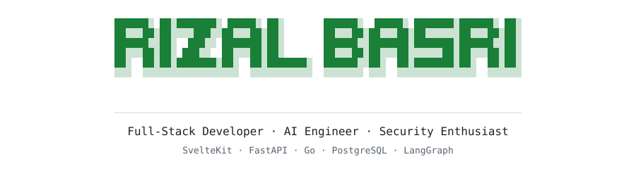
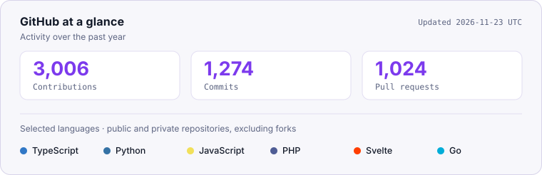

 

[Focus](#focus) · [Open Source](#open-source-contributions) · [Tech Stack](#tech-stack) · [Activity](#github-activity)

## Focus

<table>
  <tr>
    <td width="33%" valign="top">
      <h4>Full-Stack</h4>
      Web apps with SvelteKit, Next.js, FastAPI, and Go, backed by PostgreSQL.
    </td>
    <td width="33%" valign="top">
      <h4>AI Engineering</h4>
      AI agents, RAG, and explainable ML with LangGraph, PyTorch, and scikit-learn.
    </td>
    <td width="33%" valign="top">
      <h4>Security</h4>
      Learning offensive and defensive security with Kali Linux and Wireshark.
    </td>
  </tr>
</table>

## Open Source Contributions

| Project | Description |
| :--- | :--- |
| [Freesets](https://github.com/cosmoart/Freesets) | A collection of free resources, including icons, images, illustrations, components, and libraries. |
| [Baby UI](https://github.com/kanakkholwal/baby-ui) | Animated, accessible, and customizable UI components for React and Svelte. |

## Tech Stack

<table>
  <tr>
    <td width="170" valign="top"><b>Languages</b></td>
    <td>
      
      
      
      
      
      
    </td>
  </tr>
  <tr>
    <td valign="top"><b>Frontend</b></td>
    <td>
      
      
      
      
      
    </td>
  </tr>
  <tr>
    <td valign="top"><b>Backend & Data</b></td>
    <td>
      
      
      
      
      
      
    </td>
  </tr>
  <tr>
    <td valign="top"><b>AI & Data Science</b></td>
    <td>
      
      
      
      
      
      
    </td>
  </tr>
  <tr>
    <td valign="top"><b>Security & Tools</b></td>
    <td>
      
      
      
      
      
    </td>
  </tr>
</table>

## GitHub Activity

<picture>
  <source media="(prefers-color-scheme: dark)" srcset="assets/github-metrics-dark.svg">
  <source media="(prefers-color-scheme: light)" srcset="assets/github-metrics-light.svg">
  
</picture>

Refreshed once a day.

  

<picture>
  <source media="(prefers-color-scheme: dark)" srcset="https://raw.githubusercontent.com/mrizalbasri/mrizalbasri/output/snake-dark.svg">
  <source media="(prefers-color-scheme: light)" srcset="https://raw.githubusercontent.com/mrizalbasri/mrizalbasri/output/snake.svg">
  
</picture>

