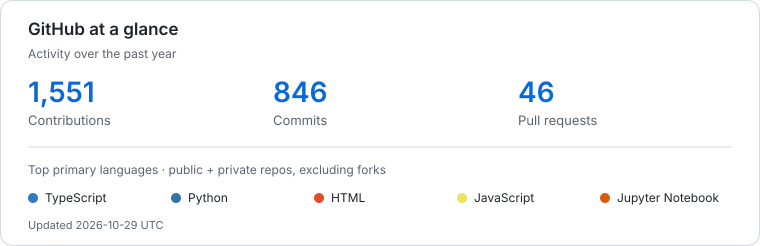

# M. Rizal Basri

[Open Source Contributions](#open-source-contributions) · [Tech Stack](#tech-stack--tools) · [Activity](#github-activity)

---

I enjoy building web applications and contributing to open source. I'm also learning more about cybersecurity and AI.

### Open Source Contributions

| Project | Description |
| :--- | :--- |
| [Freesets](https://github.com/cosmoart/Freesets) | A collection of free resources, including icons, images, illustrations, components, and libraries. |
| [Baby UI](https://github.com/kanakkholwal/baby-ui) | Animated, accessible, and customizable UI components for React and Svelte. |

### Tech Stack & Tools

Technologies I use and explore across projects and coursework.

<table>
  <tr>
    <td width="50%" valign="top">
      <h4>Languages & Core</h4>
      
      
      
      
      
      
      
      
    </td>
    <td width="50%" valign="top">
      <h4>Frameworks & Web</h4>
      
      
      
      
      
      
      
    </td>
  </tr>
  <tr>
    <td width="50%" valign="top">
      <h4>Cybersecurity & Networking</h4>
      
      
      
      
    </td>
    <td width="50%" valign="top">
      <h4>AI & Data Science</h4>
      
      
      
      
      
    </td>
  </tr>
  <tr>
    <td width="50%" valign="top">
      <h4>Databases & Server</h4>
      
      
      
    </td>
    <td width="50%" valign="top">
      <h4>Tools & Environment</h4>
      
      
      
    </td>
  </tr>
</table>

 

### GitHub Activity

<picture>
  <source media="(prefers-color-scheme: dark)" srcset="assets/github-metrics-dark.svg">
  <source media="(prefers-color-scheme: light)" srcset="assets/github-metrics-light.svg">
  
</picture>

### Contribution Graph

<picture>
  <source media="(prefers-color-scheme: dark)" srcset="https://raw.githubusercontent.com/mrizalbasri/mrizalbasri/output/pacman-contribution-graph-dark.svg">
  <source media="(prefers-color-scheme: light)" srcset="https://raw.githubusercontent.com/mrizalbasri/mrizalbasri/output/pacman-contribution-graph.svg">
  
</picture>
